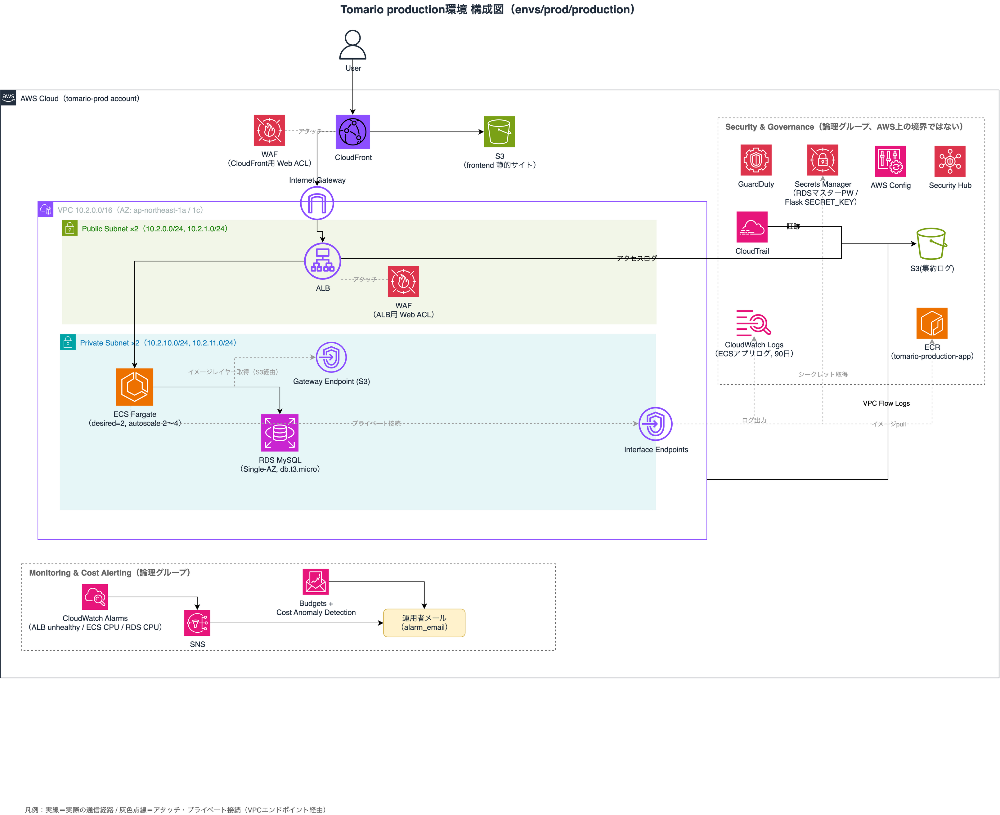

# tomario-infra

ホテル予約システム「Tomario」の AWS インフラを管理する Terraform リポジトリです。
dev（開発）・staging（負荷試験・障害試験）・production（本番）の3環境を、nonprod（dev/staging）とprod（production）の2つのAWSアカウントに分離し、staging で検証した構成をそのまま production に適用しています。

> **はじめに読む場合** — 本番構成は [`envs/prod/production/`](envs/prod/production/)、主要な実装は [`modules/backend/`](modules/backend/)（ECS Fargate + ALB）と [`modules/network/`](modules/network/)（VPC Endpoint）を参照してください。

## ディレクトリ構成

```
.
├── envs/
│   ├── nonprod/
│   │   ├── dev/       … 開発環境（network/database/backend/frontend/monitoring/logging を component 単位で分割）
│   │   ├── staging/    … 負荷試験・障害試験環境（dev同様の構成 + Auto Scaling強化）
│   │   └── shared/     … dev/staging共有のシングルトンリソース（security/cost/ecr/logging を単一 state で管理）
│   └── prod/
│       └── production/ … 本番環境（network〜logging + security/cost/ecr をフルセットで同居）
├── modules/
│   ├── network/         … VPC・Subnet・IGW・VPC Endpoint・VPC Flow Logs
│   ├── backend/         … ECS Fargate・ALB・Auto Scaling・IAM・Secrets Manager
│   ├── database/        … RDS（MySQL）
│   ├── frontend/        … CloudFront・S3（OAC）
│   ├── security/        … GuardDuty・CloudTrail・AWS Config・Security Hub
│   ├── waf/             … WAF（CloudFront用・ALB用 Web ACL、WAFログ）
│   ├── monitoring/      … CloudWatch Alarms・SNS・ダッシュボード
│   ├── logging/         … ログ集約用S3バケット
│   ├── cost/            … AWS Budgets・Cost Anomaly Detection
│   ├── ecr/             … ECR
│   ├── rds-autostop/    … 停止中のRDSが7日で自動起動したときに再停止するLambda
│   └── secret-rotation/ … Flaskのセッション署名鍵（SECRET_KEY）を自動ローテーションするLambda
├── lambda/              … 上記2つのLambdaのソースコード
├── bootstrap-nonprod/   … nonprodアカウントのOIDC・IAMロールの初期セットアップ
├── bootstrap-prod/      … prodアカウントのOIDC・IAMロールの初期セットアップ
├── .github/workflows/
│   ├── infra-ci.yml        … account_group/env/component単位でのplan/apply（OIDC認証）
│   ├── cost-stop.yml       … ECSサービスを0スケール後、ALB・Interface型VPC Endpointをterraform destroy＋RDS停止（手動実行）
│   ├── cost-start.yml      … cost-stopの逆操作（terraform applyで再作成、手動実行）
│   └── security-stack.yml  … WAF・AWS Config・Security Hubをまとめて有効化／無効化（production、承認付き）
└── docs/
    ├── architecture/              … 構成図
    └── security-stack-runbook.md  … セキュリティスタックのON/OFF手順
```

---

## アーキテクチャ（production環境）



```
User
  ↓ HTTPS
CloudFront（WAF Web ACL）
  ├── /*     → S3（静的 HTML/CSS/JS、OAC経由）
  └── /api/* → ALB（WAF Web ACL、X-Origin-Verifyヘッダーで直アクセス拒否）
                 ↓
               ECS Fargate（Graviton/ARM64、desired=2、Auto Scaling 2〜4）
                 ↓
               RDS MySQL 8.4
```

Private Subnet は NAT Gateway を使わず、VPC Endpoint（Interface × 5 + Gateway × 1）経由で ECR・Secrets Manager・CloudWatch Logs・S3 にプライベート到達しています。

---

## 環境構成

| account_group | env | 用途 |
|---|---|---|
| nonprod | dev | 開発・動作確認。壊れていい実験環境 |
| nonprod | staging | production 同等構成での負荷試験・障害試験・DR訓練 |
| nonprod | shared | dev/staging が共有する GuardDuty・CloudTrail・Budgets・ECR（アカウント単位のシングルトンリソース） |
| prod | production | 本番。security/cost/ECR も production 配下に直接同居（shared 無し） |

AWSアカウントを nonprod / prod で分離し、GitHub Actions の OIDC 認証・IAMロールもアカウントごとに独立させています。production への apply は GitHub Environment の Required reviewers による承認ゲート付きです。

---

## 前提

| 項目 | 内容 |
|---|---|
| Terraform | >= 1.10 |
| tfstate | S3 バックエンド。`use_lockfile = true`（S3 の条件付き書き込みでロック、DynamoDB 不使用） |
| state 分割 | env × component 単位（network / backend / database / frontend / monitoring / logging …ごとに独立した state） |
| Provider | hashicorp/aws |

---

## CI/CD

GitHub Actions + OIDC 認証（アクセスキー不使用）。`account_group`/`env`/`component` の単位で matrix 実行し、変更のあったコンポーネントのみ plan/apply します。production への apply は GitHub Environment の Required reviewers による承認ゲート付きです。

---

## 設計のポイント

### コスト管理（cost-stop / cost-start）
使わないときは ECS サービスを desired-count 0 にし、ALB と Interface 型 VPC Endpoint を `terraform destroy -target` で削除、RDS を停止して費用を最小化します。cost-start はこれらを `terraform apply` で作り直します。GitHub Actions のワークフローから account_group/env を指定して手動実行できます。production もリリース前は同じ cost-stop 運用で、リリース後に常時稼働へ切り替える設計です。

### セキュリティ
- GitHub Actions から AWS への認証は **OIDC**（アクセスキー不使用）。production は GitHub Environment 経由の信頼条件 + Required reviewers の承認ゲートで二重に保護
- ALB は CloudFront 経由以外のリクエストを **X-Origin-Verify ヘッダー検証**で 403 拒否（直アクセス不可）
- DB認証情報・Flask SECRET_KEY は **Secrets Manager** で管理
- GuardDuty（脅威検出）・CloudTrail（証跡）は常時有効
- WAF（CloudFront用・ALB用の2 Web ACL、AWS Managed Rule Groups）・AWS Config・Security Hub は、1つのフラグ（`enable_security_stack`）でまとめて有効化／無効化する。コストを抑えるため、現在は必要な期間だけ有効化している（`security-stack.yml`）
- Flask のセッション署名鍵は Secrets Manager で90日ごとに自動ローテーション（1つ前の鍵も受け付け、ローテーションでログインが切れない）
- S3 はパブリックアクセスを完全ブロックし、**OAC** 経由の CloudFront のみ許可

### 可用性・耐障害性
staging 環境での実測値：
- ECS デプロイサーキットブレーカーによる自動ロールバック（失敗検知からロールバック完了まで約1分50秒）
- Application Auto Scaling（CPU使用率ベース、負荷試験で確認）
- タスク強制停止からの自動復旧（1分未満）
- RDS ポイントインタイムリストア訓練（RTO 約14分）

### ネットワーク
NAT Gateway は使用せず、VPC Endpoint（Interface: ECR API/DKR・Secrets Manager・CloudWatch Logs・SSM Messages、Gateway: S3）でプライベート通信のみで完結させ、コストと外部露出を最小化しています。

---

## コスト概算

| 状況 | dev / staging | production |
|---|---|---|
| 停止時（cost-stop、通常時） | ~$1.55 / 月 | ~$1.8 / 月（リリース前） |
| 稼働時（作業・負荷試験） | ~$55 / 月相当（時間課金） | ~$115 / 月（常時稼働後） |

production 常時稼働後の内訳は ALB・ECS Fargate（0.5vCPU/1GB×2タスク）・VPC Endpoint・RDS（Single-AZ。Multi-AZ はコストとの比較で見送り）など。WAF・Security Hub/Config は常時稼働させず、検証時のみ作成・有効化する運用です。

---

## 関連リポジトリ

| リポジトリ | 内容 |
|---|---|
| [Tomario-portfolio](https://github.com/Tomario-portfolio/Tomario-portfolio) | ポートフォリオ全体の入り口・各リポジトリへのリンク |
| [tomario-app](https://github.com/Tomario-portfolio/tomario-app) | Flask API + 静的フロントエンド |
| [tomario-docs](https://github.com/Tomario-portfolio/tomario-docs) | 要件定義書・基本設計書・環境定義書 |
| [tomario-steering](https://github.com/Tomario-portfolio/tomario-steering) | ADR・非機能試験・運用手順・リリース管理 |
